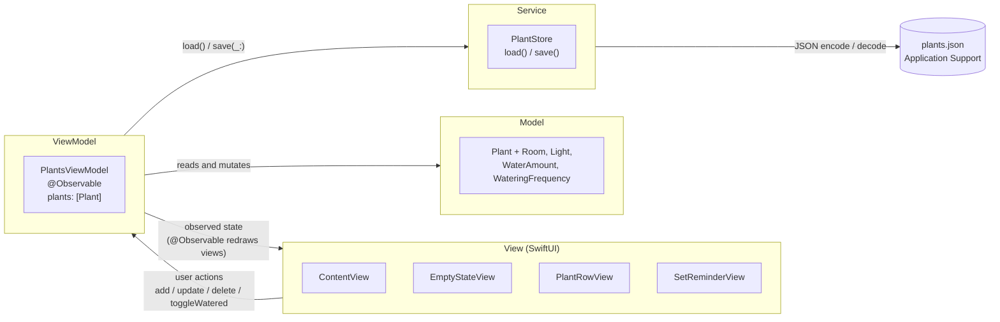
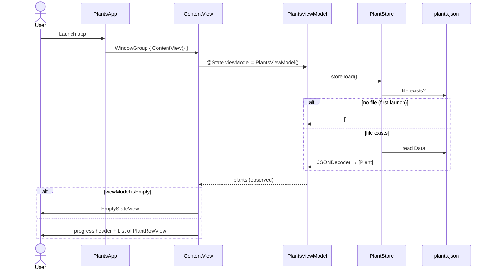
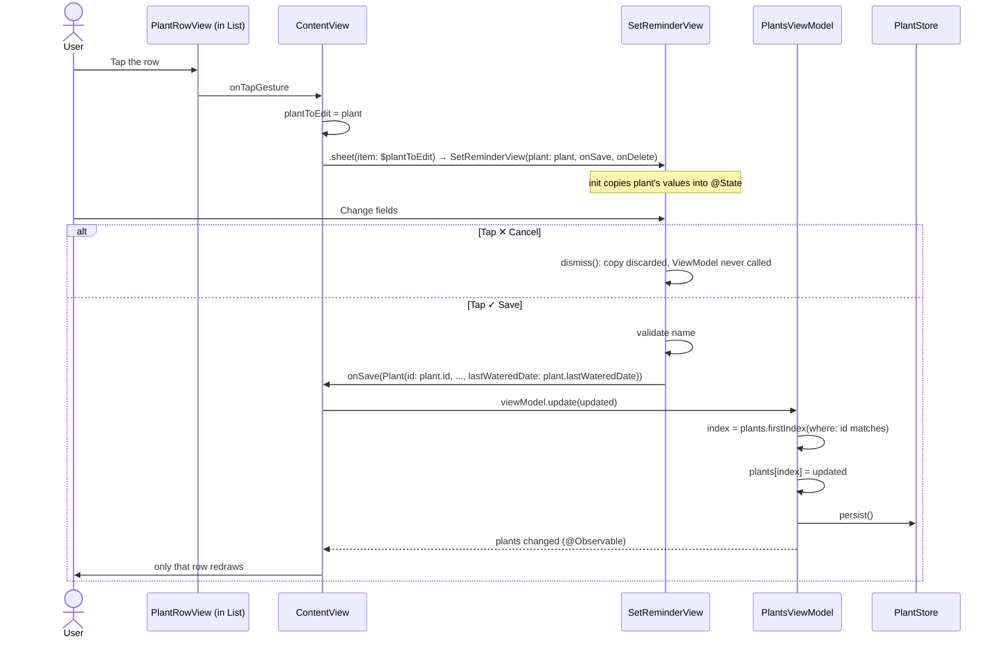

# Plant by berryy 🌱

A SwiftUI iOS app for keeping track of your houseplants: where each one lives, how much light and water it needs, and whether you've watered it today.

This document explains how the app is structured with **MVVM** and walks through exactly what happens, call by call, when a plant is **created, read, updated and deleted** (CRUD).

---

## Contents

1. [Architecture at a glance](#architecture-at-a-glance)
2. [Layers and responsibilities](#layers-and-responsibilities)
3. [File map](#file-map)
4. [State: who owns what](#state-who-owns-what)
5. [CRUD flows](#crud-flows)
   - [Read (launch and display)](#read-launch-and-display)
   - [Create (add a plant)](#create-add-a-plant)
   - [Update (edit a plant, toggle watered)](#update-edit-a-plant-toggle-watered)
   - [Delete (swipe or edit sheet)](#delete-swipe-or-edit-sheet)
6. [How data is stored](#how-data-is-stored)
7. [Design decisions](#design-decisions)
8. [Known limitations](#known-limitations)

---

## Architecture at a glance



**The rule that keeps it clean:** data flows down, actions flow up.

- Views **display** state and **forward** user actions. They never touch the file or mutate the plants array.
- The ViewModel **owns the truth** (`plants`) and decides what every action means.
- The Service is the **only** code that knows plants are stored as JSON on disk.
- The Model is plain data with no UI and no storage code.

---

## Layers and responsibilities

| Layer | Responsibility | Knows about | Does not know about |
|---|---|---|---|
| **Model** | Describes what a plant is, plus small rules about its own data (`isWatered`). | Foundation | Views, storage |
| **View** | Draws state, captures taps and text input, forwards actions upward via closures. | ViewModel (`ContentView` only), Model | Files, JSON |
| **ViewModel** | Holds the list of plants, applies add/update/delete/toggle, computes progress, triggers saving. | Model, Service | SwiftUI views |
| **Service** | Reads and writes the plants file. | Model (`Codable`) | Views, ViewModel |

`PlantsViewModel` imports only `Foundation`, `Observation` and `OSLog`, not `SwiftUI`, so its logic can be tested without any UI.

---

## File map

```
Plant by berryy/
├── App/
│   └── PlantsApp.swift            App entry point, shows ContentView
├── Model/
│   └── Plant.swift                Plant struct + Room, Light, WaterAmount, WateringFrequency enums (all Codable)
├── ViewModels/
│   └── PlantsViewModel.swift      Source of truth for plants; add / update / delete / toggleWatered
├── Services/
│   └── PlantStore.swift           JSON load/save to Application Support
└── Views/
    ├── ContentView.swift          Main page; owns the ViewModel and all sheet/dialog state
    ├── EmptyStateView.swift       Shown when there are no plants
    ├── PlantRowView.swift         One list row (check circle, room, name, chips)
    ├── SetReminderView.swift      Add AND edit form (edit mode adds the Delete button)
    └── PlantColors.swift          Light/dark color palette
```

| File | Responsible for |
|---|---|
| `PlantsApp.swift` | Launching the app and presenting `ContentView`. |
| `Plant.swift` | The shape of the data and how it is encoded (`Codable`). `isWatered` is true when `lastWateredDate` is today. |
| `PlantsViewModel.swift` | **All CRUD logic.** The only code that changes `plants`. Calls `persist()` after every change. |
| `PlantStore.swift` | **All disk access.** `load()` returns `[Plant]`, `save(_:)` writes them atomically. |
| `ContentView.swift` | Creates the ViewModel, decides empty state vs list, owns `plantToEdit`, `plantToDelete`, `showingSetReminder`, presents the sheets and the delete confirmation. |
| `SetReminderView.swift` | The form. Edits a **copy** of the plant in local `@State`, then hands the result up through `onSave` / `onDelete`. |
| `PlantRowView.swift` | Renders one plant and reports the check-circle tap through `onToggleWatered`. |
| `EmptyStateView.swift` | Renders the empty screen and reports the button tap through `onAddTapped`. |

---

## State: who owns what

| State | Type | Owner | Meaning |
|---|---|---|---|
| `plants` | `[Plant]` | `PlantsViewModel` | The single source of truth. `private(set)`, so views can read but never write it. |
| `viewModel` | `PlantsViewModel` | `ContentView` (`@State`) | Created once for the screen's lifetime. |
| `showingSetReminder` | `Bool` | `ContentView` | Presents the **add** sheet. |
| `plantToEdit` | `Plant?` | `ContentView` | Non-nil presents the **edit** sheet (`.sheet(item:)`); setting it to nil dismisses it. |
| `plantToDelete` | `Plant?` | `ContentView` | Non-nil shows the swipe-delete confirmation dialog. |
| `name`, `room`, `light`, `waterAmount`, `wateringFrequency` | form fields | `SetReminderView` (`@State`) | A **working copy** while the sheet is open. Initialised from the plant being edited. |
| `showDeleteConfirmation` | `Bool` | `SetReminderView` | Shows the confirmation for the Delete button inside the edit sheet. |

Because `Plant` is a **struct** (a value type), the sheet holds its own copy. Nothing in `plants` changes until the user taps Save, so **Cancel needs no undo code**: closing the sheet discards the copy.

---

## CRUD flows

`@Observable` is what connects ViewModel to View. When `ContentView.body` reads `viewModel.plants`, SwiftUI remembers that dependency. When `plants` changes, SwiftUI re-runs only the views that read it. No manual refresh call exists anywhere.

### Read (launch and display)



1. `PlantsApp` shows `ContentView`.
2. `ContentView` creates `PlantsViewModel()`. Its `init` calls `store.load()`.
3. `PlantStore.load()` returns `[]` if there is no file yet, otherwise decodes the JSON into `[Plant]`. On a decoding error the ViewModel logs it and starts with `[]`.
4. `body` reads `viewModel.isEmpty` and shows `EmptyStateView` or the list.
5. The progress header reads `wateredTodayCount` and `wateredTodayProgress`, both computed from `plants`.

### Create (add a plant)

```mermaid
sequenceDiagram
    actor User
    participant CV as ContentView
    participant SR as SetReminderView
    participant VM as PlantsViewModel
    participant PS as PlantStore
    participant FS as plants.json

    User->>CV: Tap "+" (or the empty-state button)
    CV->>CV: showingSetReminder = true
    CV->>SR: present sheet, SetReminderView(plant: nil)
    User->>SR: Type name, pick room / light / water / frequency
    Note over SR: Values live in the sheet's own @State
    User->>SR: Tap ✓ Save
    SR->>SR: trim name; empty? show error and stop
    SR->>CV: onSave(Plant(id: UUID(), ...))
    SR->>SR: dismiss()
    CV->>VM: viewModel.add(plant)
    VM->>VM: plants.append(plant)
    VM->>PS: persist() → store.save(plants)
    PS->>FS: JSONEncoder → atomic write
    VM-->>CV: plants changed (@Observable)
    CV->>User: new row appears, progress recalculates
```

| Step | File | What happens |
|---|---|---|
| 1 | `ContentView` / `EmptyStateView` | The `+` button or the empty-state button sets `showingSetReminder = true`. |
| 2 | `ContentView` | `.sheet(isPresented:)` presents `SetReminderView` with no plant, which means **add mode** (no Delete button). |
| 3 | `SetReminderView` | Fields start with defaults (`.bedroom`, `.fullSun`, `.small`, `.everyDay`). |
| 4 | `SetReminderView.save()` | Trims the name. If empty it sets `showNameError = true` and returns, so nothing is saved. |
| 5 | `SetReminderView.save()` | Builds a `Plant` with a **new `UUID()`** and calls `onSave(plant)`, then `dismiss()`. |
| 6 | `ContentView` | The `onSave` closure calls `viewModel.add(plant)`. |
| 7 | `PlantsViewModel.add` | Appends to `plants`, then `persist()`. |
| 8 | `PlantStore.save` | Creates the folder if needed, encodes the **whole array**, writes with `.atomic`. |
| 9 | SwiftUI | The change to `plants` re-renders the list. If it was the first plant, `isEmpty` flips to `false` and `EmptyStateView` is replaced by the list. |

### Update (edit a plant, toggle watered)

There are two kinds of update.

#### A. Edit the plant's details



| Step | File | What happens |
|---|---|---|
| 1 | `ContentView` | `.onTapGesture { plantToEdit = plant }` on the row, with `.contentShape(Rectangle())` so the whole row is tappable. The check circle is its own `Button`, so it wins its own taps. |
| 2 | `ContentView` | `.sheet(item: $plantToEdit)` presents the form. It works because `Plant` is `Identifiable`. |
| 3 | `SetReminderView.init` | Copies the plant's values into `@State`. The form edits a **copy**. |
| 4 | `SetReminderView.save()` | Builds a `Plant` that **keeps the original `id` and `lastWateredDate`**. Keeping the id is how the ViewModel finds the right plant. Keeping the date means editing a name does not un-water the plant. |
| 5 | `PlantsViewModel.update` | Finds the index by **id** (never by name, since names can repeat and are the thing being edited), replaces the element, calls `persist()`. If the id is not found, it does nothing. |
| 6 | SwiftUI | Only the changed row redraws. |

#### B. Toggle "watered today"

1. The user taps the check circle in `PlantRowView`.
2. The row calls its `onToggleWatered` closure, which `ContentView` wired to `viewModel.toggleWatered(plant)`.
3. `PlantsViewModel.toggleWatered` finds the plant by id and sets `lastWateredDate` to `Date()`, or to `nil` if it was already watered today (tap again to undo). Then `persist()`.
4. The row switches between the empty ring and the green check, and the progress bar and message recompute from `wateredTodayCount`.

### Delete (swipe or edit sheet)

Both entry points ask for confirmation, then converge on the **same** ViewModel method.

```mermaid
sequenceDiagram
    actor User
    participant CV as ContentView
    participant SR as SetReminderView
    participant VM as PlantsViewModel
    participant PS as PlantStore

    rect rgb(40, 40, 40)
    Note over User,VM: Path A: swipe left on a row
    User->>CV: Swipe left, tap 🗑
    CV->>CV: plantToDelete = plant
    CV->>User: confirmationDialog "Delete <name>?"
    alt Cancel / tap outside
        CV->>CV: plantToDelete = nil (nothing deleted)
    else Delete
        CV->>VM: viewModel.delete(plant)
    end
    end

    rect rgb(40, 40, 40)
    Note over User,VM: Path B: inside the edit sheet
    User->>SR: Tap "Delete Reminder"
    SR->>SR: showDeleteConfirmation = true
    SR->>User: confirmationDialog "Delete <name>?"
    User->>SR: Delete
    SR->>CV: onDelete()
    CV->>VM: viewModel.delete(plant)
    SR->>SR: dismiss()
    end

    VM->>VM: plants.removeAll { $0.id == plant.id }
    VM->>PS: persist()
    VM-->>CV: plants changed (@Observable)
    CV->>User: row disappears; if it was the last plant, EmptyStateView is shown
```

| Step | File | What happens |
|---|---|---|
| 1 | `ContentView` | `.swipeActions(allowsFullSwipe: false)` shows an icon-only red trash. Full swipe is disabled so a long swipe can never delete without confirmation. |
| 2 | `ContentView` | Tapping the trash only sets `plantToDelete = plant`. **It does not delete.** |
| 3 | `ContentView` | `confirmationDialog(presenting: plantToDelete)` shows "Delete <name>?" with a red Delete and a system Cancel. |
| 4 | `ContentView` | Confirming calls `viewModel.delete(plant)`. Cancelling clears `plantToDelete`. |
| 5 | `PlantsViewModel.delete` | `plants.removeAll { $0.id == plant.id }`, then `persist()`. |
| 6 | SwiftUI | The row disappears. If `plants` is now empty, `isEmpty` is `true` and the main screen switches to `EmptyStateView`. |

---

## How data is stored

`PlantStore` writes one JSON file:

```
<app sandbox>/Library/Application Support/plants.json
```

Example content after adding one plant:

```json
[
  {
    "id": "6F1C2B7A-3D4E-4B8A-9C10-2A5E7D9F0B11",
    "name": "Orchid",
    "room": "Living Room",
    "light": "Full Sun",
    "waterAmount": "20-50 ml",
    "wateringFrequency": 1,
    "lastWateredDate": 816000000.5
  }
]
```

- `Plant` and its four enums conform to `Codable`, so Swift generates the encoding. Enums are stored by **raw value**; dates as seconds; a `nil` date is omitted.
- Every change rewrites the **whole array**. At this scale (a handful to a few hundred plants) that is a few KB and effectively instant.
- Writes use `.atomic` (temp file, then swap), so a crash mid-save cannot leave a half-written file.
- The in-memory array is the live copy the UI uses; the file is the saved copy that survives relaunch.

---

## Design decisions

**Why a JSON file and not UserDefaults?** UserDefaults is meant for small preferences and is loaded wholesale at launch. A growing list of records belongs in its own file, which also gives real errors you can log rather than silent failures.

**Why not SwiftData (yet)?** For one flat list, JSON is simpler and easy to inspect. All disk code lives behind `PlantStore`, so moving to SwiftData later means rewriting that one file; the views keep working.

**Why a `Services/` folder?** `PlantStore` is not a Model (it does not describe a plant), a ViewModel (no screen state) or a View. "Service" is the usual name for a helper that talks to something outside the app's own logic, here the disk.

**Why does the edit sheet work on a copy?** `Plant` is a struct, so the form cannot change the saved list by accident. Cancel is free, and only Save reaches the ViewModel.

**Why identify plants by `id`?** Names repeat and change; a `UUID` never does.

**Why `sheet(item:)` for editing?** The presented plant and the sheet's visibility are one value, so they can never disagree.

---

## Known limitations

- **Corrupt file:** if `plants.json` cannot be decoded, the app logs the error and starts empty; the next save overwrites it.
- **Enum raw values are persisted.** Renaming one (for example `"Full Sun"`) would stop old files from decoding. Add a separate display title instead of changing raw values.
- **`wateringFrequency` is displayed but not yet used** to work out when a plant is due; "watered today" only checks whether `lastWateredDate` is today.
- **No reminders/notifications yet.**
- **Single file, whole-array writes:** fine at this scale. A watering *history* (one entry per watering) would be the point to move to SwiftData.
