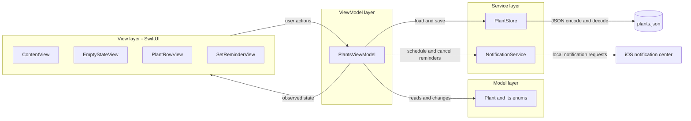
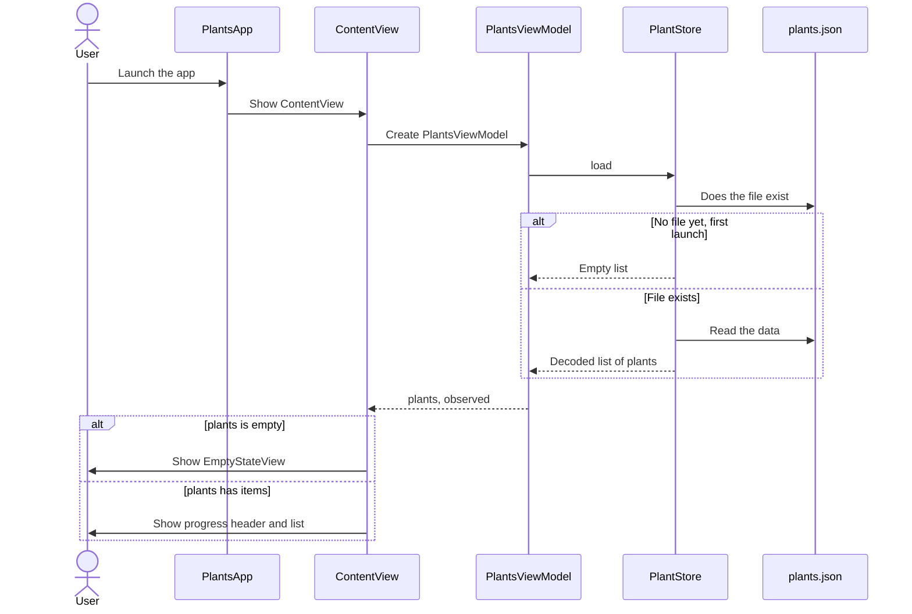
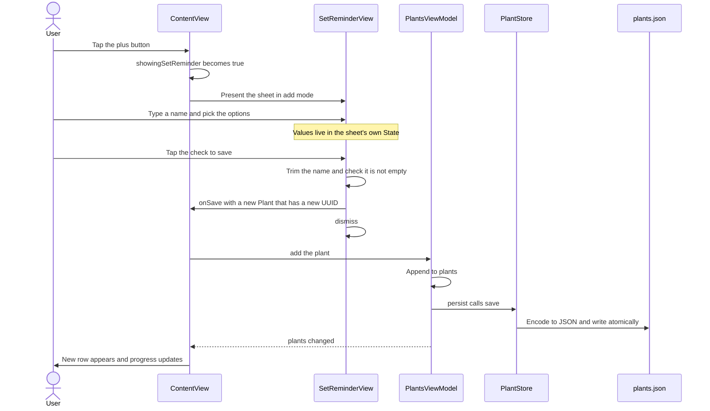
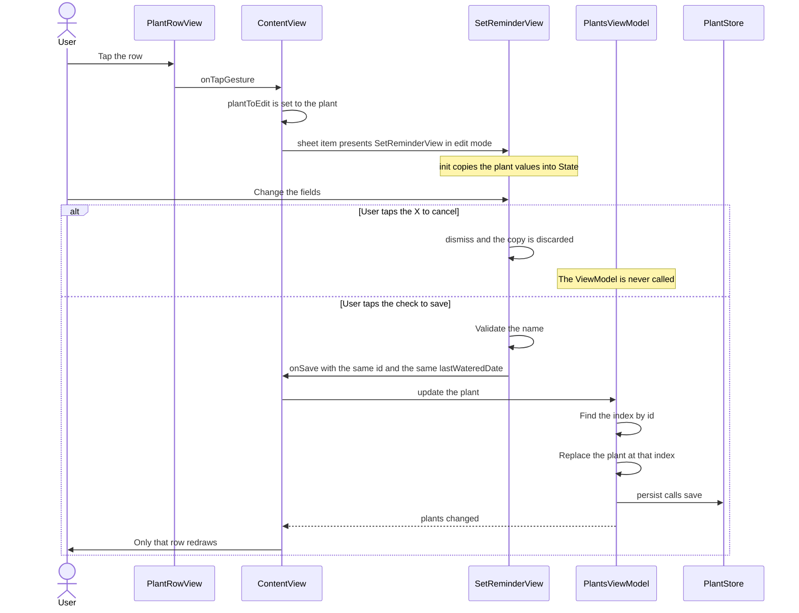
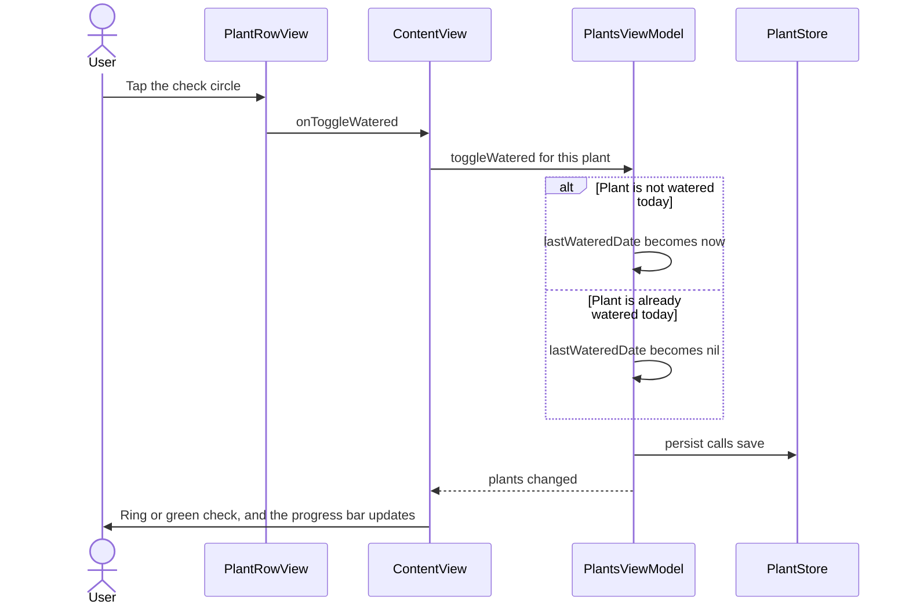
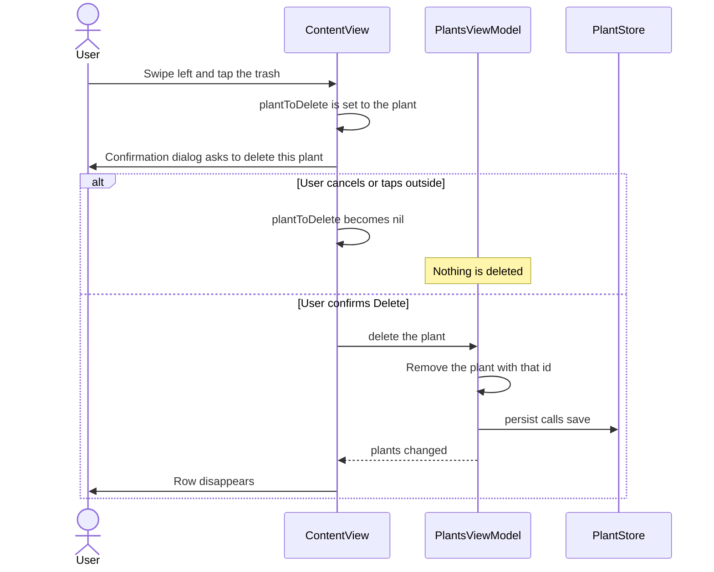
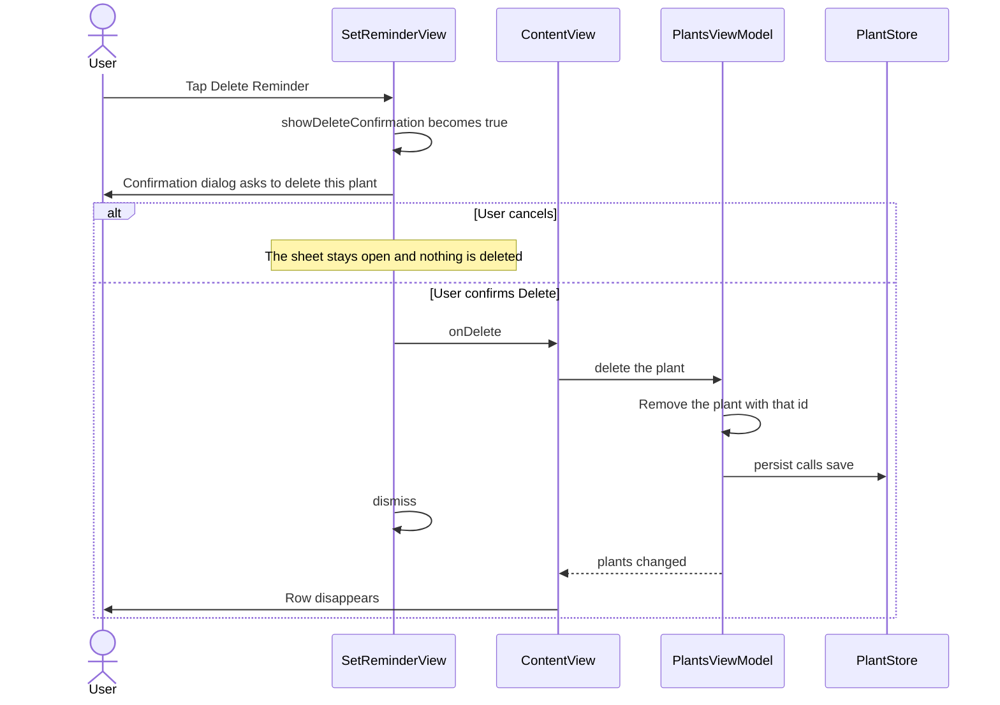
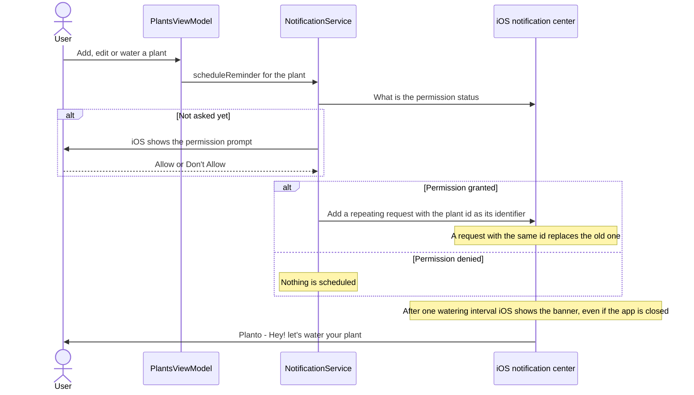

# Planto 🌱

**Planto** is an iOS app for keeping track of your houseplants. Save each plant with its room, light and watering needs, then tick it off every day when you've watered it.

---

## Main features

What users can do in the current build:

- **Add a plant.** Enter a name and choose the room, the light it needs, how much water it needs and how often to water it.
- **See all your plants in one list.** Each row shows the plant's name, its room, and its light and water needs.
- **Mark a plant as watered today.** Tap the circle next to a plant. Tap again to undo it.
- **Track daily progress.** A progress bar and a message show how many of your plants you've watered today.
- **Edit a plant.** Tap any plant to change its details.
- **Delete a plant.** Swipe left and tap the trash, or use "Delete Reminder" in the edit screen. The app always asks for confirmation first.
- **Get watering reminders.** Each plant sends a notification ("Hey! let's water your plant") every time its watering interval passes. Watering a plant restarts its countdown.
- **Keep your plants between launches.** Plants are saved on the device, so they're still there when you reopen the app.
- **Use light or dark mode.** The app follows your phone's appearance setting.
- **Get a friendly empty screen.** When there are no plants yet, the app invites you to add your first one.

Choices available when adding or editing a plant:

| Setting | Options |
|---|---|
| Room | Bedroom, Living Room, Kitchen, Balcony, Bathroom |
| Light | Full Sun, Partial Sun, Low Light |
| Water | 20-50 ml, 50-100 ml, 100-200 ml, 200-300 ml |
| Watering days | Every day, every 2 days, every 3 days, once a week, every 10 days, every 2 weeks |

---

## Technologies used

| Technology | Used for |
|---|---|
| Swift and SwiftUI | The whole app and its user interface |
| MVVM | Separating screens, logic and data |
| Observation (`@Observable`) | Updating the screen automatically when the data changes |
| Codable and JSON | Converting plants to and from a saved format |
| FileManager | Reading and writing the `plants.json` file on the device |
| UserNotifications | Local notifications that remind the user to water a plant |
| OSLog | Logging load, save and scheduling errors |
| Liquid Glass (`glassEffect`) | The floating add button and the empty-screen button |
| Xcode | Building and previewing, targeting iOS 27 |

---

# Architecture and CRUD documentation

The rest of this document explains how the app is built with **MVVM**, and exactly what happens, call by call, when a plant is **created, read, updated and deleted** (CRUD).

## Contents

1. [Architecture at a glance](#architecture-at-a-glance)
2. [Layers and responsibilities](#layers-and-responsibilities)
3. [File map](#file-map)
4. [State: who owns what](#state-who-owns-what)
5. [CRUD flows](#crud-flows)
   - [Read: launch and display](#read-launch-and-display)
   - [Create: add a plant](#create-add-a-plant)
   - [Update: edit a plant and toggle watered](#update-edit-a-plant-and-toggle-watered)
   - [Delete: swipe or edit sheet](#delete-swipe-or-edit-sheet)
6. [Reminder notifications](#reminder-notifications)
7. [How data is stored](#how-data-is-stored)
8. [Design decisions](#design-decisions)
9. [Known limitations](#known-limitations)

---

## Architecture at a glance



**The rule that keeps it clean: data flows down, actions flow up.**

- Views **display** state and **forward** user actions. They never touch the file or change the plants array.
- The ViewModel **owns the truth** (`plants`) and decides what every action means.
- The Services are the **only** code that know about the disk (`PlantStore`) and about iOS notifications (`NotificationService`).
- The Model is plain data with no UI and no storage code.

---

## Layers and responsibilities

| Layer | Responsibility | Knows about | Does not know about |
|---|---|---|---|
| **Model** | Describes what a plant is, plus small rules about its own data (`isWatered`). | Foundation | Views, storage |
| **View** | Draws state, captures taps and text input, forwards actions upward through closures. | ViewModel (`ContentView` only), Model | Files, JSON |
| **ViewModel** | Holds the list of plants, applies add, update, delete and toggle, computes progress, triggers saving. | Model, Service | SwiftUI views |
| **Service** | Talks to the outside world: reads and writes the plants file (`PlantStore`) and schedules reminders with iOS (`NotificationService`). | Model (`Codable`) | Views, ViewModel |

`PlantsViewModel` imports only `Foundation`, `Observation` and `OSLog`, not `SwiftUI`, so its logic can be tested without any UI.

---

## File map

```
Plant by berryy/
├── App/
│   └── PlantsApp.swift            App entry point, shows ContentView
├── Model/
│   └── Plant.swift                Plant struct plus Room, Light, WaterAmount, WateringFrequency (all Codable)
├── ViewModels/
│   └── PlantsViewModel.swift      Source of truth for plants: add, update, delete, toggleWatered
├── Services/
│   ├── PlantStore.swift           JSON load and save in Application Support
│   └── NotificationService.swift  Permission, scheduling and cancelling of reminder notifications
└── Views/
    ├── ContentView.swift          Main page, owns the ViewModel and all sheet and dialog state
    ├── EmptyStateView.swift       Shown when there are no plants
    ├── PlantRowView.swift         One list row: check circle, room, name, chips
    ├── SwipeToDeleteRow.swift     Row wrapper: slide left to reveal the red trash pill
    ├── SetReminderView.swift      Add AND edit form (edit mode adds the Delete button)
    └── PlantColors.swift          Light and dark color palette
```

| File | Responsible for |
|---|---|
| `PlantsApp.swift` | Launching the app and presenting `ContentView`. |
| `Plant.swift` | The shape of the data and how it is encoded (`Codable`). `isWatered` is true when `lastWateredDate` is today. |
| `PlantsViewModel.swift` | **All CRUD logic.** The only code that changes `plants`. Calls `persist()` after every change and keeps each plant's reminder in step with it. |
| `PlantStore.swift` | **All disk access.** `load()` returns `[Plant]`, `save(_:)` writes them atomically. |
| `NotificationService.swift` | **All notification access.** Asks for permission, schedules one repeating reminder per plant, cancels it, and lets banners show while the app is open. |
| `ContentView.swift` | Creates the ViewModel, chooses between the empty state and the list, owns `plantToEdit`, `plantToDelete` and `showingSetReminder`, and presents the sheets and the delete confirmation. |
| `SetReminderView.swift` | The form. Edits a **copy** of the plant in local `@State`, then hands the result up through `onSave` and `onDelete`. |
| `PlantRowView.swift` | Renders one plant and reports the check-circle tap through `onToggleWatered`. |
| `SwipeToDeleteRow.swift` | Wraps a row. A horizontal drag slides it left and reveals a 62 x 45 red trash pill. Tapping the pill calls `onDelete`. It never deletes anything itself. |
| `EmptyStateView.swift` | Renders the empty screen and reports the button tap through `onAddTapped`. |
| `PlantColors.swift` | The colors, each with a light and a dark value. |

---

## State: who owns what

| State | Type | Owner | Meaning |
|---|---|---|---|
| `plants` | `[Plant]` | `PlantsViewModel` | The single source of truth. `private(set)`, so views can read it but never write it. |
| `viewModel` | `PlantsViewModel` | `ContentView` (`@State`) | Created once for the screen's lifetime. |
| `showingSetReminder` | `Bool` | `ContentView` | Presents the **add** sheet. |
| `plantToEdit` | `Plant?` | `ContentView` | Non-nil presents the **edit** sheet (`.sheet(item:)`). Setting it to nil dismisses the sheet. |
| `plantToDelete` | `Plant?` | `ContentView` | Non-nil shows the swipe-delete confirmation dialog. |
| `name`, `room`, `light`, `waterAmount`, `wateringFrequency` | form fields | `SetReminderView` (`@State`) | A **working copy** while the sheet is open, initialised from the plant being edited. |
| `showDeleteConfirmation` | `Bool` | `SetReminderView` | Shows the confirmation for the Delete button inside the edit sheet. |

Because `Plant` is a **struct** (a value type), the sheet holds its own copy. Nothing in `plants` changes until the user taps Save, so **Cancel needs no undo code**. Closing the sheet discards the copy.

---

## CRUD flows

`@Observable` is what connects the ViewModel to the View. When `ContentView.body` reads `viewModel.plants`, SwiftUI remembers that dependency. When `plants` changes, SwiftUI re-runs only the views that read it. No manual refresh call exists anywhere.

### Read: launch and display



1. `PlantsApp` shows `ContentView`.
2. `ContentView` creates `PlantsViewModel()`. Its `init` calls `store.load()`.
3. `PlantStore.load()` returns `[]` if there is no file yet, otherwise it decodes the JSON into `[Plant]`. On a decoding error the ViewModel logs it and starts with `[]`.
4. `body` reads `viewModel.isEmpty` and shows `EmptyStateView` or the list.
5. The progress header reads `wateredTodayCount` and `wateredTodayProgress`, both computed from `plants`.

### Create: add a plant



| Step | File | What happens |
|---|---|---|
| 1 | `ContentView` or `EmptyStateView` | The `+` button or the empty-state button sets `showingSetReminder = true`. |
| 2 | `ContentView` | `.sheet(isPresented:)` presents `SetReminderView` with no plant, which means **add mode** (no Delete button). |
| 3 | `SetReminderView` | The fields start with defaults: `.bedroom`, `.fullSun`, `.small`, `.everyDay`. |
| 4 | `SetReminderView.save()` | Trims the name. If it is empty it sets `showNameError = true` and stops, so nothing is saved. |
| 5 | `SetReminderView.save()` | Builds a `Plant` with a **new `UUID()`**, calls `onSave(plant)`, then `dismiss()`. |
| 6 | `ContentView` | The `onSave` closure calls `viewModel.add(plant)`. |
| 7 | `PlantsViewModel.add` | Appends to `plants`, then calls `persist()`. |
| 8 | `PlantStore.save` | Creates the folder if needed, encodes the **whole array**, writes it with `.atomic`. |
| 9 | SwiftUI | The change to `plants` re-renders the list. If it was the first plant, `isEmpty` becomes `false` and `EmptyStateView` is replaced by the list. |

### Update: edit a plant and toggle watered

There are two kinds of update.

#### A. Edit the plant's details



| Step | File | What happens |
|---|---|---|
| 1 | `ContentView` | `.onTapGesture { plantToEdit = plant }` on the row, with `.contentShape(Rectangle())` so the whole row is tappable. The check circle is its own `Button`, so it handles its own taps. |
| 2 | `ContentView` | `.sheet(item: $plantToEdit)` presents the form. It works because `Plant` is `Identifiable`. |
| 3 | `SetReminderView.init` | Copies the plant's values into `@State`. The form edits a **copy**. |
| 4 | `SetReminderView.save()` | Builds a `Plant` that **keeps the original `id` and `lastWateredDate`**. Keeping the id is how the ViewModel finds the right plant. Keeping the date means editing a name does not un-water the plant. |
| 5 | `PlantsViewModel.update` | Finds the index by **id** (never by name, because names can repeat and are the thing being edited), replaces the element, calls `persist()`. If the id is not found, it does nothing. |
| 6 | SwiftUI | Only the changed row redraws. |

#### B. Toggle "watered today"



1. The user taps the check circle in `PlantRowView`.
2. The row calls its `onToggleWatered` closure, which `ContentView` connected to `viewModel.toggleWatered(plant)`.
3. `PlantsViewModel.toggleWatered` finds the plant by id and sets `lastWateredDate` to `Date()`, or to `nil` if it was already watered today (tap again to undo). Then it calls `persist()`.
4. The row switches between the empty ring and the green check. The progress bar and message are recomputed from `wateredTodayCount`.

### Delete: swipe or edit sheet

Both entry points ask for confirmation, then call the **same** ViewModel method.

#### A. Swipe left on a row



#### B. "Delete Reminder" inside the edit sheet



| Step | File | What happens |
|---|---|---|
| 1 | `SwipeToDeleteRow` | A leftward drag slides the row and reveals the red trash pill. Release past halfway and it snaps open, otherwise it snaps closed. Mostly vertical drags are ignored, so the List still scrolls. There is no full swipe, so a long swipe can never delete without confirmation. |
| 2 | `ContentView` | Tapping the trash calls the row's `onDelete`, which only sets `plantToDelete = plant`. **It does not delete.** |
| 3 | `ContentView` | `confirmationDialog(presenting: plantToDelete)` shows the plant's name with a red Delete button and a system Cancel. |
| 4 | `ContentView` | Confirming calls `viewModel.delete(plant)`. Cancelling clears `plantToDelete`. |
| 5 | `PlantsViewModel.delete` | `plants.removeAll { $0.id == plant.id }`, then `persist()`. |
| 6 | SwiftUI | The row disappears. If `plants` is now empty, `isEmpty` is `true` and the main screen switches to `EmptyStateView`. |

---

## Reminder notifications

Each plant gets one reminder that shows on the lock screen and in Notification Center:

> **Planto**
> Hey! let's water your plant

### Local notifications, not remote push

These are **local notifications**. The app asks iOS to show them at a future time, and iOS does so even when the app is closed. There is no server involved. A *remote* push notification would need a server, Apple's push service (APNs), certificates and a device token, none of which this app needs because it already knows when each plant is due.

### How it works



1. **Permission.** iOS only allows notifications if the user agrees. `requestAuthorizationIfNeeded()` asks the **first time a reminder is scheduled** (when the first plant is added), not at launch, so the prompt appears when it makes sense. After that it only reads the answer.
2. **Content.** `UNMutableNotificationContent` holds the title ("Planto"), the body and the sound.
3. **Trigger.** A `UNTimeIntervalNotificationTrigger` with `repeats: true` fires every N days, where N is the plant's `wateringFrequency.rawValue`. The first banner arrives one full interval after the reminder was scheduled.
4. **Identifier.** The request uses the plant's `UUID` as its identifier. That gives exactly one reminder per plant, and scheduling again simply **replaces** the old one.
5. **Hand-off to iOS.** After `center.add(request)`, iOS owns the reminder. The app does not need to be running for it to fire.

### What each CRUD action does to the reminder

| Action | ViewModel method | Effect on the reminder |
|---|---|---|
| Create | `add` | Schedules a reminder. This is where the permission prompt appears the first time. |
| Update | `update` | Reschedules, because the watering frequency may have changed. |
| Toggle watered | `toggleWatered` | Reschedules, so the countdown restarts from the moment the plant was watered. It also clears an old banner from Notification Center. |
| Delete | `delete` | Cancels the pending reminder and removes any delivered banner. |
| App launch | `init` | Schedules a reminder only for plants that **don't have one yet** (for example plants saved before reminders existed). Existing reminders are never moved. |

### While the app is open

By default iOS hides notifications from an app that is on screen. `NotificationService` is the notification center's delegate, and its `willPresent` method returns `[.banner, .sound]`, so the banner still shows. The delegate must live for the whole app, which is why the service is a shared singleton (`NotificationService.shared`): the center keeps only a weak reference to its delegate.

---

## How data is stored

`PlantStore` writes one JSON file:

```
<app sandbox>/Library/Application Support/plants.json
```

Example content after adding one plant:

```json
[
  {
    "id": "6F1C2B7A-3D4E-4B8A-9C10-2A5E7D9F0B11",
    "name": "Orchid",
    "room": "Living Room",
    "light": "Full Sun",
    "waterAmount": "20-50 ml",
    "wateringFrequency": 1,
    "lastWateredDate": 816000000.5
  }
]
```

- `Plant` and its four enums conform to `Codable`, so Swift generates the encoding. Enums are stored by **raw value**, dates as seconds, and a `nil` date is left out.
- Every change rewrites the **whole array**. At this scale (a handful to a few hundred plants) that is a few KB and effectively instant.
- Writes use `.atomic` (a temporary file, then a swap), so a crash in the middle of a save cannot leave a half-written file.
- The in-memory array is the live copy the UI uses. The file is the saved copy that survives a relaunch.
- The file path is checked with `path(percentEncoded: false)`. Without it, the space in "Application Support" becomes `%20` and the app thinks the file is missing.

---

## Design decisions

**Why a JSON file and not UserDefaults?** UserDefaults is meant for small preferences and is loaded wholesale at launch. A growing list of records belongs in its own file, which also gives real errors you can log instead of silent failures.

**Why not SwiftData (yet)?** For one flat list, JSON is simpler and easy to inspect. All disk code lives behind `PlantStore`, so moving to SwiftData later means rewriting that one file. The views keep working.

**Why a `Services/` folder?** `PlantStore` is not a Model (it does not describe a plant), not a ViewModel (it holds no screen state) and not a View. "Service" is the usual name for a helper that talks to something outside the app's own logic, here the disk.

**Why does the edit sheet work on a copy?** `Plant` is a struct, so the form cannot change the saved list by accident. Cancel is free, and only Save reaches the ViewModel.

**Why identify plants by `id`?** Names repeat and change. A `UUID` never does.

**Why `sheet(item:)` for editing?** The presented plant and the sheet's visibility are one value, so they can never disagree.

**Why local notifications instead of remote push?** The app already knows when each plant is due, so it can schedule the reminder itself. That means no server, no Apple Push Notification service setup and no account system.

**Why one reminder per plant, identified by the plant's `id`?** Re-scheduling the same id replaces the old request, so edits and waterings can never leave duplicate reminders behind.

**Why ask for permission when the first plant is added?** A prompt that appears at the moment the user creates a reminder is easy to understand. A prompt at first launch, before the user has done anything, is more likely to be refused.

**Why a hand-built swipe instead of SwiftUI's `swipeActions`?** The system draws an icon-only swipe action as a 50 x 50 circle and does not allow changing its size or shape. The design calls for a 62 x 45 capsule, so `SwipeToDeleteRow` builds the swipe with a `DragGesture`. It is attached with `simultaneousGesture` so the List can still scroll, and it adds a VoiceOver "Delete" action to replace the system swipe action.

**Why Liquid Glass on only two buttons?** Liquid Glass is meant for controls that float above content, so the floating add button and the empty-screen button use `glassEffect`. The rows, chips and progress bar are content and stay flat. Apple also advises limiting how many glass effects are on screen at once.

---

## Known limitations

- **Corrupt file:** if `plants.json` cannot be decoded, the app logs the error and starts empty. The next save overwrites it.
- **Enum raw values are persisted.** Renaming one (for example `"Full Sun"`) would stop old files from decoding. Add a separate display title instead of changing raw values.
- **Reminders are not tied to a time of day.** The countdown starts when the reminder is scheduled, so a plant added at 3 pm is reminded at 3 pm. A time-of-day setting would need a field on `Plant` and a calendar trigger.
- **Reminders count from the last change, not from a due date.** `wateringFrequency` sets the reminder interval, but the app does not yet show which plants are overdue. "Watered today" only checks whether `lastWateredDate` is today.
- **Denied permission means no reminders.** If the user taps Don't Allow, nothing is scheduled. They can turn notifications on later in iOS Settings, and the launch check will schedule the missing reminders.
- **iOS keeps at most 64 pending local notifications** per app. One per plant is fine for a normal collection, but a very large one would need a different scheme.
- **The swipe is custom, not the system one.** It has no haptic feedback and only a small overshoot instead of the system's rubber-band effect. Each row tracks its own state, so opening a second row does not close the first.
- **Notification wording is fixed** ("Planto" / "Hey! let's water your plant") and does not say which plant.
- **Single file with whole-array writes:** fine at this scale. A watering *history* (one entry per watering) would be the point to move to SwiftData.
